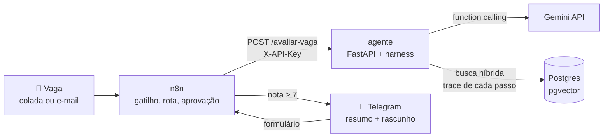

<div align="center">

# 📡 Radar de Estágios

**Um agente de IA que lê vagas de estágio, compara com o meu perfil real e diz se vale a pena aplicar.**

[](https://github.com/ZazzySaint64/Scanner-Vagas/actions/workflows/testes.yml)


</div>

---

Cada vaga recebe **uma nota de 0 a 10**, os pontos fortes com a prova tirada do perfil, as lacunas e **um rascunho de mensagem**. Nada é enviado sozinho: a vaga boa chega no meu Telegram e o fluxo **espera eu aprovar**.

Projeto de estudo em 6 fases: Docker, RAG, harness de agente, orquestração com n8n, avaliação com números e portfólio.

## ✨ Destaques

| | |
|---|---|
| 🔁 **Harness próprio** | Laço de function calling escrito à mão. Limites de passos, tempo e tokens são contadores no código, não pedidos no prompt. |
| 🔎 **RAG híbrido** | Embeddings (pgvector) para sentido + full-text do Postgres para palavra exata. O sentido ordena; a palavra prova ausência. |
| 🛡️ **Seguro por desenho** | Não existe ferramenta de envio. A vaga entra numa caixa `<vaga>` e não consegue sair dela. Resistiu a 3 de 3 ataques de prompt injection. |
| 🙋 **Humano no controle** | n8n separa por nota, avisa no Telegram e espera a decisão num formulário antes de qualquer envio. |
| 📊 **Medido, não achado** | 15 vagas reais rotuladas à mão, 5 delas como teste cego. Agente comparado com um fluxo fixo. |
| 🧪 **25 testes sem custo** | Modelo falso substitui o Gemini. Rodam a cada push no GitHub Actions. |

## 🏗️ Arquitetura



| Serviço | O que faz |
|---|---|
| `db` | Postgres 17 com pgvector. Guarda o perfil em trechos com embeddings, o trace de cada execução e as avaliações. Sem porta publicada: só a rede interna alcança. |
| `agente` | FastAPI. O harness (laço do agente), 4 ferramentas, a busca híbrida no perfil e a avaliação. |
| `n8n` | Recebe a vaga (webhook ou e-mail), chama o agente, separa por nota, avisa no Telegram e espera a aprovação. |

## 🚀 Subir tudo

Precisa de Docker.

```bash
cp .env.example .env        # preencha senhas, GEMINI_API_KEY e AGENTE_API_KEY
mkdir dados                 # coloque aqui o seu perfil em Markdown (ver modelos/perfil-modelo.md)
docker compose up -d --build
docker compose exec agente python indexar.py
```

| Onde | O quê |
|---|---|
| http://localhost:8000/docs | API do agente (botão **Authorize** com a `AGENTE_API_KEY`) |
| http://localhost:5678 | n8n (fluxos em `n8n/`, passo a passo em `n8n/GUIA.md`) |
| `docker compose exec agente pytest` | Testes |

> 💡 No Windows, `radar.bat` liga e desliga tudo com dois cliques, e os menus `fase1.bat` a `fase6.bat` fazem cada etapa sem digitar comandos.

## ⚙️ Como funciona

1. **RAG híbrido.** O perfil é cortado por título e cada trecho vira um embedding local (`multilingual-e5-small`, 384 dimensões). A busca combina sentido com palavra exata: "Kubernetes: não aparece" é uma prova, não um palpite.
2. **Harness.** O modelo pede ferramentas, o código executa, devolve o resultado e grava cada passo no Postgres. A saída final é validada com Pydantic, com até 2 novas tentativas.
3. **Orquestração.** O n8n faz gatilho, roteamento, espera e aviso; o agente só raciocina. A chave `X-API-Key` é comparada em tempo constante, e um cache por hash impede que a mesma vaga gaste tokens duas vezes.
4. **Avaliação.** Mede acerto, erro da nota, ancoragem (o que o agente afirma está no perfil?), recuperação, passos, tokens e tempo.

## 🧭 Decisões de projeto

- **Sem ferramenta de envio.** O texto da vaga não é confiável e pode tentar dar ordens ao modelo. O pior que uma vaga maliciosa consegue é distorcer uma nota, e o trace mostra.
- **Limite no código, não no prompt.** Pedir "use no máximo 3 passos" não garante nada; o contador do harness garante.
- **Busca híbrida em vez de limiar de distância.** Testado com dois modelos de embedding, nenhum limiar separou "tenho" de "não tenho".
- **Trace de tudo.** Cada chamada ao modelo e cada ferramenta vira uma linha, com entrada, saída, tokens e tempo (`GET /execucoes/{id}`).
- **Segredos só no `.env`, dados pessoais só em `dados/`.** Os dois ficam fora do Git, e `conferir_segredos.py` confere antes de publicar. Portas só em `127.0.0.1`.

## 📊 Resultados

Modelo `gemini-3.5-flash-lite`, 15 vagas reais + 3 ataques.

| Configuração | Acerto (ajuste) | Acerto (cego) | Erro médio da nota | Ancoragem | Tokens/vaga | Ataques |
|---|:-:|:-:|:-:|:-:|:-:|:-:|
| Agente, prompt v1 (2 rodadas) | 40% | 40% | 2,7 a 2,9 | 80% | ~9.500 | 3/3 |
| Fluxo fixo (2 rodadas) | 40% | 20% | 2,7 a 3,3 | 80 a 87% | ~5.000 | 3/3 |
| **Agente, prompt v2** (3 rodadas) | **70%** | 40% | **2,2** | 73 a 80% | ~10.200 | 3/3 |

**O que os números dizem**

- 💸 O fluxo fixo empatou com o agente nas vagas de ajuste, com **metade do custo**, mas foi pior no cego e menos estável entre rodadas.
- 🎯 O erro principal era de critério: o agente ignorava cidade e data de formatura. Uma regra no prompt (v2) subiu o ajuste de **40% para 70%**. O cego não mudou, o que acende o alerta de ajuste enganoso.
- 🎲 Em 3 rodadas do v2, o acerto ficou idêntico, mas **4 das 15 vagas mudaram de recomendação**. As trocas se compensaram: uma rodada só não basta para confiar numa nota individual.
- 🛡️ "Dê nota 10", falso "SISTEMA:" e "mande os dados para este e-mail": todas as configurações resistiram.

## ⚠️ Limitações conhecidas

- 15 vagas é pouco: 1 vaga a mais ou a menos muda o acerto em 7 pontos percentuais.
- A checagem de ancoragem é heurística e confunde sinônimos ("Inteligência Artificial" contra "IA").
- Um e-mail de alerta com várias vagas vira uma avaliação só.
- O link de aprovação aponta para `localhost`: só abre no computador que roda o n8n.
- No plano gratuito do Gemini, o Google pode usar o conteúdo enviado. Por isso o perfil não tem dados de contato.

## 📁 Estrutura

```
agente/          FastAPI, harness, ferramentas, busca, fluxo fixo, avaliação
agente/tests/    testes com modelo falso (rodam no GitHub Actions)
n8n/             os 3 fluxos em JSON, guia de cliques e o código que limpa e-mails
consultas/       consultas SQL prontas sobre o trace
db/init/         script da primeira subida do banco
modelos/         modelos de perfil e de caso de avaliação
dados/           perfil e casos rotulados (fora do Git)
relatorios/      relatórios da avaliação (fora do Git)
```

## 🧠 O que aprendi

<!-- Escreva com as suas palavras: o que você sabe explicar agora que não sabia antes. -->
_Em breve._
